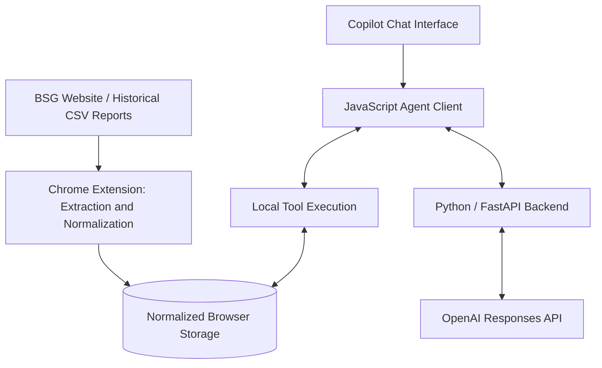

# BSG AI Copilot

A full-stack, AI-powered strategy assistant for the **Business Strategy Game (BSG)**. The project combines a Chrome extension, a normalized historical data store, and a tool-using AI agent to analyze competitive performance, evaluate live decisions, and maintain strategic continuity throughout a business simulation.

Built as an applied AI and software engineering project, the Copilot evolved from a data extraction tool into a domain-specific decision-support system. It was used during a competitive footwear simulation involving 12 companies, with results evaluated across Years 11–20.

## Key Features

- **Data extraction and normalization:** Imports BSG CSV reports and extracts live decision-page data directly from the browser, organizing historical results by industry, year, company, and report type.
- **AI-powered analysis:** Uses 24 specialized function tools for historical retrieval, competitor benchmarking, financial analysis, cross-year comparisons, and projection-to-actual comparisons.
- **Live decision support:** Captures current decisions and projected outcomes, tracks snapshot freshness, and supports revalidation when changes affect other decision areas.
- **Domain knowledge:** Integrates 55 sections of the BSG Player's Guide alongside a persistent store of simulation mechanics findings.
- **Persistent strategic memory:** Maintains overall and yearly strategies, revision history, weekly continuity reports, and decision-session state across agent interactions.
- **Context and cost optimization:** Uses selective retrieval, compact tool outputs, bounded strategy context, and token-usage profiling to reduce unnecessary model input.
- **Human-in-the-loop workflow:** Provides recommendations and analysis while leaving final simulation decisions to the user.

## Technology Stack

| Layer | Technologies |
| --- | --- |
| Frontend | JavaScript, HTML, CSS, Chrome Extensions API (Manifest V3) |
| Data layer | CSV parsing, DOM extraction, normalized JSON, `chrome.storage.local` |
| Backend | Python, FastAPI, Uvicorn, Pydantic |
| AI | OpenAI Responses API, function calling, prompt caching |
| Development | Git, GitHub |

## System Architecture



The backend manages model requests, system instructions, and tool definitions. When the model requests evidence, the extension executes the relevant tools against browser-local data and returns structured results. This iterative architecture avoids sending the entire historical dataset with every prompt.

Historical actuals, practice data, current projections, and persistent strategy state are stored separately to prevent different types of evidence from being conflated.

## Engineering Highlights

| Metric | Result |
| --- | ---: |
| JavaScript and Python source lines | 29,128 |
| Agent function tools | 24 |
| Player's Guide knowledge sections | 55 |
| Documented Git commits | 15 |
| Historical payload reduction (benchmark) | 94.3% |
| Subsequent API input token reduction (benchmark) | 83.8% |

One of the project's major engineering challenges was excessive context consumption during historical analysis. Selective data retrieval and compact tool outputs reduced a tested historical response from **200,783 to 11,515 JSON characters**, with the subsequent API call decreasing from **73,300 to 11,840 input tokens**.

### API Usage and Cost

Recorded usage from August 29 to November 26, 2026:

| Metric | Result |
| --- | ---: |
| API requests | 1,948 |
| Total tokens | 45.72 million |
| Recorded expenditure | $66.29 |
| Average cost per API request | $0.034 |
| First-to-final reporting period expenditure | $36.87 → $4.37 |
| Recorded spending reduction | 88.1% |

The optimization benchmark was reconstructed from development logs and represents a specific tested retrieval path. Aggregate billing figures are organization-level; project attribution assumes matching usage scope. Spending also depends on workload and model usage, so the full 88.1% decline cannot be attributed solely to engineering optimizations.

## Simulation Results

The Copilot supported strategic analysis for Company H (Hadidas), Industry 42. The company reached second place game-to-date in Year 19 and finished fifth overall out of 12 competitors.

| Performance metric | Year 11 | Year 20 |
| --- | ---: | ---: |
| Revenue | $452.3M | $750.7M |
| Net profit | $45.4M | $211.8M |
| Earnings per share | $2.27 | $14.12 |
| Return on equity | 19.5% | 38.0% |
| Net profit margin | 10.0% | 28.2% |
| Overall rank | 6th | 5th |

Over the simulation, revenue increased **66.0%**, net profit increased **365.9%**, and EPS increased **522.0%**. Despite substantial financial improvement, weaker brand image, limited market reach, and a final-year stock-price decline constrained the competitive outcome.

These are simulated company results, not a controlled measurement of the Copilot's causal impact. Incomplete decision archives limit attribution of individual outcomes to AI recommendations.

## Repository Structure

```text
BSG-AI-Copilot/
├── backend/
│   ├── agent.py              # Agent instructions and Responses API orchestration
│   ├── main.py               # FastAPI endpoints
│   ├── tools.py              # Function tool schemas
│   └── requirements.txt
└── extension/
    ├── content.js            # BSG page extraction
    ├── bsgDataAccess.js       # Storage and analytical functions
    ├── bsgAgentTools.js       # Local tool execution
    ├── bsgAgentClient.js      # Agent request and tool-call loop
    ├── popup.html             # Extension interface
    ├── popup.css
    ├── popup.js               # UI, imports and workflow management
    ├── manifest.json
    └── data/
        └── playersGuide.json  # Structured domain knowledge
```

## Local Setup

Requires Google Chrome, Python, an OpenAI API key with API access, and access to the BSG simulation and/or its exported reports.

### 1. Start the backend

```bash
git clone https://github.com/z3tr68/BSG-AI-Copilot.git
cd BSG-AI-Copilot/backend
python3 -m venv .venv
source .venv/bin/activate
python -m pip install -r requirements.txt
```

Create a `.env` file inside `backend/`:

```dotenv
OPENAI_API_KEY=your_api_key_here
OPENAI_MODEL=your_supported_model_id
```

Set `OPENAI_MODEL` to a Responses API model available to your project that supports function calling. Never commit API credentials.

```bash
python -m uvicorn main:app --host 127.0.0.1 --port 8000
```

The backend status endpoint is available at `http://127.0.0.1:8000/`.

### 2. Load the Chrome extension

1. Open `chrome://extensions/` and enable **Developer mode**.
2. Select **Load unpacked** and choose the repository's `extension/` directory.
3. Import historical BSG CSV reports through the extension's Historical Data view, or capture a supported BSG page through the Current Round view.
4. Open the Copilot chat and submit a question with the relevant data loaded.

The runtime historical dataset is not included in the repository. The current agent instructions are tailored to Company H; adapt the configuration and instructions for other simulations.

## Limitations and Future Work

This is a local, single-user prototype rather than a production-ready service. Future improvements include durable database storage and backups, versioned decision and recommendation archives, automated parser and agent evaluation tests, structured telemetry, stronger API access controls, and configurable company-specific instructions.

## Project Status

Completed as a semester-long applied AI project in November 2026. Technical metrics reflect the November 15 source snapshot (`938abe7`); usage and simulation results were evaluated through November 26. The local setup instructions are based on the committed source and have not been independently smoke-tested for this README.
